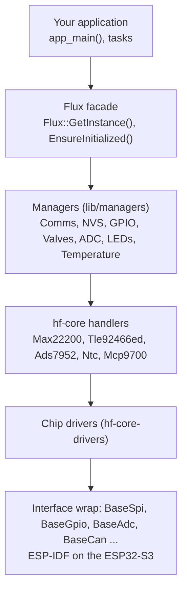

# HardFOC Flux V1 HAL

Hardware abstraction layer for the **HardFOC Flux V1** valve control board: an ESP32-S3 driving eight solenoid
valves (MAX22200), six proportional valves (TLE92466ED), twelve external analog inputs (ADS7952), temperatures, CAN
and a status LED, through one `Flux` object.

[](https://github.com/hardfoc/hf-hal-flux-v1/actions/workflows/esp32-examples-build-ci.yml)
[](https://github.com/hardfoc/hf-hal-flux-v1/actions/workflows/ci-docs-publish.yml)
[](https://hardfoc.github.io/hf-hal-flux-v1/)
[](LICENSE)

**Documentation: <https://hardfoc.github.io/hf-hal-flux-v1/>**

## Architecture

Your application talks to the `Flux` facade; each layer calls only the one below it.



The site explains each layer: [architecture](https://hardfoc.github.io/hf-hal-flux-v1/latest/architecture/),
[managers](https://hardfoc.github.io/hf-hal-flux-v1/latest/managers/),
[hardware and pin map](https://hardfoc.github.io/hf-hal-flux-v1/latest/hardware/).

## Quick start

You need ESP-IDF release/v5.5 (`esp32s3` target) and a Flux V1 board on USB.

```bash
git clone --recurse-submodules https://github.com/hardfoc/hf-hal-flux-v1.git
cd hf-hal-flux-v1/examples/esp32
./scripts/build_app.sh flux_api_test Release
./scripts/flash_app.sh flash_monitor flux_api_test Release
```

The log shows one row per manager (`OK`, `WARN` or `FAIL`). Step by step, with how to tell each step worked:
[Get started](https://hardfoc.github.io/hf-hal-flux-v1/latest/quickstart/).

## Use it

```cpp
#include "api/Flux.h"
#include "managers/ValveManager.h"

extern "C" void app_main() {
    auto& flux = Flux::GetInstance();
    if (!flux.EnsureInitialized()) {
        return;  // NVS, comms or GPIO failed
    }

    // Solenoid valve: 800 mA for 50 ms to pull in, then hold at 200 mA.
    if (HfValveErrOk(flux.valves.ConfigureSolenoidCdr(ValveChannel::SOL_CH0, 800, 200, 50.0f))) {
        (void)flux.valves.EnableChannel(ValveChannel::SOL_CH0);
    }

    float board_c = 0.0f;
    (void)flux.temp.ReadNtcTemperature(board_c);
    (void)flux.leds.IndicateReady();
}
```

## Repository layout

| Path | Contents |
| --- | --- |
| `lib/api` | The `Flux` facade, version information, CPU affinity constants |
| `lib/managers` | One manager per board function |
| `lib/core` | hf-core submodule: handlers, chip drivers, interface wrap, the pin map (`hf-pincfg`) |
| `examples/esp32` | Buildable example and test apps ([catalogue](https://hardfoc.github.io/hf-hal-flux-v1/latest/examples/)) |
| `docs` | The documentation site (MkDocs); figures and tables are generated from the code |
| `_config` | Doxygen, lint and link-check configuration |

## Contributing

Pull requests run the example build, C++ lint and analysis, Markdown and YAML lint, and the docs checks; see
[Testing and CI](https://hardfoc.github.io/hf-hal-flux-v1/latest/testing/). If you change a pin, an
example or a manager's dependencies, run `hardfoc-docs gen` and `hardfoc-docs figures` and commit
the result.

## License

GPL-3.0. See [LICENSE](LICENSE).
