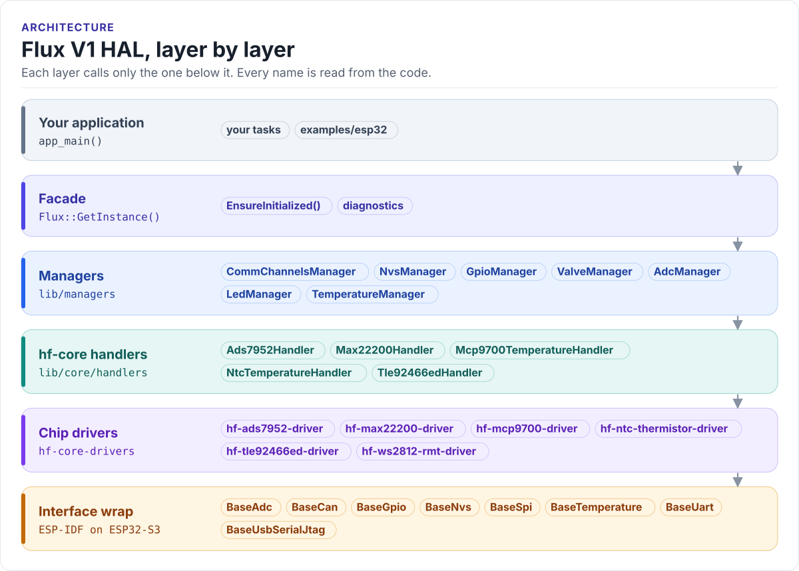

# Architecture

How the Flux V1 HAL is put together. The short version: your code talks to one object, `Flux`; `Flux` holds one
manager per board function; managers own hf-core handlers; handlers wrap chip drivers; drivers reach the hardware
only through the interface classes of the internal interface wrap. The objects behind those interfaces are created
by a platform binding, one per MCU family, which is the only code that includes ESP-IDF.

<!-- figure: hal-layers -->
<picture>
  <source media="(prefers-color-scheme: dark)" srcset="../diagrams/hal-layers.dark.svg">
  
</picture>
<!-- /figure -->

## The layers

| Layer | Where | What it does | You use it when |
| --- | --- | --- | --- |
| Application | your project, [`examples/esp32`](../../examples/esp32) | Tasks, control loops, protocols | Always |
| Facade | [`lib/api/Flux.h`](../../lib/api/Flux.h) | One singleton; brings the managers up in order; system diagnostics | Always: `Flux::GetInstance()` |
| Managers | [`lib/managers`](../../lib/managers) | One per board function (valves, ADC, temperature, ...); know the board's wiring from the pin map; MCU-free | Almost always: `flux.valves`, `flux.adc`, ... |
| Platform binding | [`lib/managers/bsp_bind`](../../lib/managers/bsp_bind) | Turns the managers' plain-data specs into `Base*` objects; `esp32s3/` is the only ESP-IDF code in the HAL | When porting to another MCU ([Platform bindings](bindings.md)) |
| hf-core handlers | `lib/core/handlers` | Wrap one chip driver each and adapt it to the interface classes | Rarely; for chip features a manager does not expose |
| Chip drivers | `lib/core/hf-core-drivers/external` | Register-level drivers, one repository per chip | Almost never from application code |
| Interface wrap | `lib/core/hf-core-drivers/internal/hf-internal-interface-wrap` | `BaseSpi`, `BaseGpio`, `BaseAdc`, ... and their ESP32 implementations (`EspSpi`, `EspGpio`, ...), which only the binding names | When porting to another MCU |

The rule that holds the design together: **a layer only calls the layer below it.** The managers are the only code
that knows Flux V1 exists; handlers and drivers are shared with other HardFOC boards. Why the line is drawn there is
recorded in [ADR 0001](../adr/0001-mcu-agnostic-boundary.md); why the MCU objects are created in a binding and not
in the managers is [ADR 0004](../adr/0004-platform-bindings.md), and a lint in CI keeps it that way.

## Read on

- [Platform bindings](bindings.md): what the binding creates, the families, and the boundary lint.
- [Initialisation](initialization.md): the order the managers come up and what happens when one fails.
- [Ownership](ownership.md): which manager creates which handler, and how memory is allocated.
- [Threading](threading.md): which calls are safe from several tasks.
- [Errors and diagnostics](errors.md): error enums, `GetLastError()`, health snapshots.
