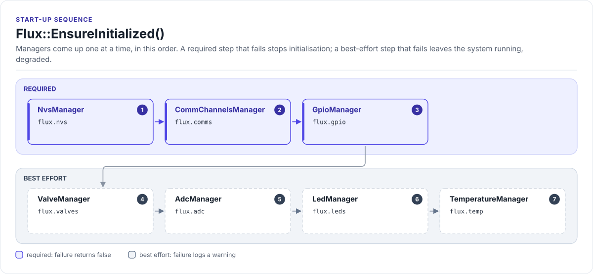

# Initialisation

`Flux::EnsureInitialized()` brings every manager up, one at a time, in a fixed order. Call it once, early in
`app_main()`, before you touch any manager.

<!-- figure: init-order -->
<picture>
  <source media="(prefers-color-scheme: dark)" srcset="../diagrams/init-order.dark.svg">
  
</picture>
<!-- /figure -->

## The order

<!-- generated: init-order -->
Generated by `tools/docs/gen.py` from [`Flux.cpp`](../../lib/api/Flux.cpp)
(`Flux::InitializeAllComponents`); do not edit.

| Step | Manager | Member | If it fails |
| ---: | --- | --- | --- |
| 1 | `NvsManager` | `flux.nvs` | **initialisation fails** (`EnsureInitialized()` returns false) |
| 2 | `CommChannelsManager` | `flux.comms` | **initialisation fails** (`EnsureInitialized()` returns false) |
| 3 | `GpioManager` | `flux.gpio` | **initialisation fails** (`EnsureInitialized()` returns false) |
| 4 | `ValveManager` | `flux.valves` | warning; the system runs degraded |
| 5 | `AdcManager` | `flux.adc` | warning; the system runs degraded |
| 6 | `LedManager` | `flux.leds` | warning; the system runs degraded |
| 7 | `TemperatureManager` | `flux.temp` | warning; the system runs degraded |
<!-- /generated -->

The order follows the dependencies: storage first, so configuration and calibration are available early; then the
buses; then the GPIO pins the valve drivers need; then the managers that use them. `TemperatureManager` comes after
`AdcManager` because the NTC and MCP9700 sensors are read through ADC channels.

## What happens when a step fails

- **Required steps (NVS, comms, GPIO).** If one fails, `EnsureInitialized()` logs the failure, stops and returns
  `false`. `IsInitialized()` stays `false`, and calling `EnsureInitialized()` again retries from the start.
- **Best-effort steps (valves, ADC, LEDs, temperature).** A failure is logged as a `WARN` row in the start-up table
  and the manager stays unavailable; the remaining steps still run and `EnsureInitialized()` returns `true`. Check
  `flux.valves.IsInitialized()` (or the [diagnostics](errors.md)) before relying on a best-effort manager.

This lets a bench with only some chips fitted, or with the 24 V valve supply off, still come up and log.

Inside a best-effort manager the same idea repeats. `ValveManager` tries the TLE92466ED and the MAX22200 separately
and succeeds if either works; `TemperatureManager` succeeds if any one of its three sensors works; `AdcManager`
succeeds if any channel registered. Each logs which parts are missing.

## Calling a manager directly

Every manager also has its own `EnsureInitialized()`, and the managers that depend on others call those first (for
example `ValveManager` calls `CommChannelsManager` and `GpioManager`). So code that uses one manager on its own
works, but going through `Flux::EnsureInitialized()` gives you the logged start-up table and the system diagnostics.

## Start-up log

A healthy start prints one row per step, with its time:

```text
  1  NVS             OK      ...
  2  Comms           OK      ...
  3  GPIO            OK      ...
  4  Valves          OK      ...
  5  ADC             OK      ...
  6  LEDs            OK      ...
  7  Temp            OK      ...
Flux API initialized in ... ms
```

`FAIL` marks a required step that failed, `WARN` a best-effort step that failed.

## Shutting down

`Flux::Shutdown()` de-initialises the managers in reverse order (temperature, LEDs, ADC, GPIO, comms, NVS).

!!! warning "Valves are not de-initialised by `Shutdown()`"
    `Flux::Shutdown()` skips `ValveManager` (see the comment in [`Flux.cpp`](../../lib/api/Flux.cpp)). Disable the
    valve channels yourself (`flux.valves.DisableAllChannels()`) before shutting down.
