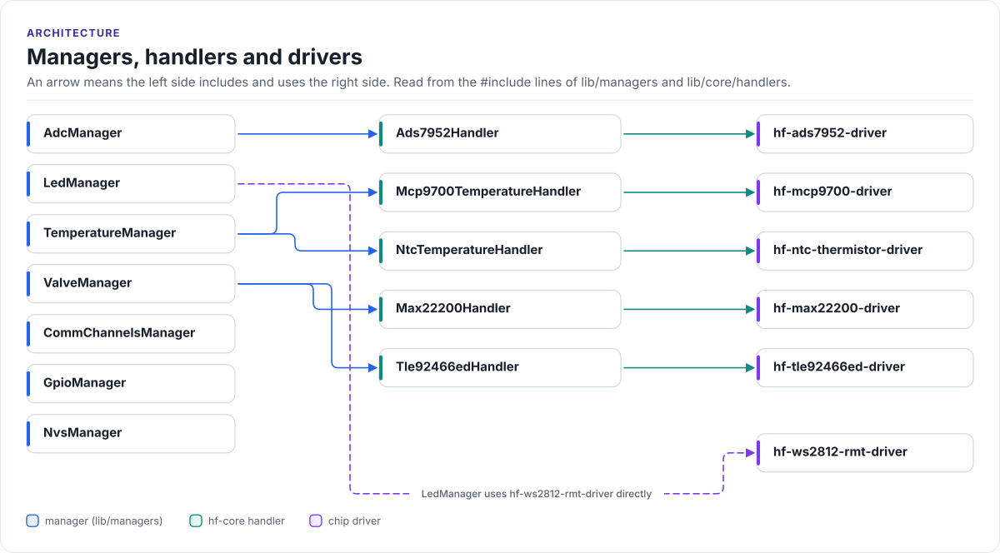

# Ownership

Who creates what, who owns it, and how long it lives. In one sentence: every manager is a function-local static
singleton that lives for the whole program, and each manager creates and owns the handlers and bus objects it needs
during its own initialisation.

<!-- figure: manager-dependencies -->
<picture>
  <source media="(prefers-color-scheme: dark)" srcset="../diagrams/manager-dependencies.dark.svg">
  
</picture>
<!-- /figure -->

## Manager map

<!-- generated: manager-map -->
Generated by `tools/docs/gen.py` from the `#include` lines of
[`lib/managers`](../../lib/managers) and the hf-core handlers; do not edit.

| Manager | Uses managers | hf-core handlers (driver) | Drivers used directly | Interface classes |
| --- | --- | --- | --- | --- |
| [`AdcManager`](../../lib/managers/AdcManager.h) | `CommChannelsManager` | `ads7952` (hf-ads7952) | - | `BaseAdc`, `EspAdc` |
| [`CommChannelsManager`](../../lib/managers/CommChannelsManager.h) | - | - | - | `BaseCan`, `BaseSpi`, `BaseUart`, `BaseUsbSerialJtag`, `EspCan`, `EspSpi`, `EspUart`, `EspUsbSerialJtag` |
| [`GpioManager`](../../lib/managers/GpioManager.h) | - | - | - | `BaseGpio`, `EspGpio` |
| [`LedManager`](../../lib/managers/LedManager.h) | - | - | `hf-ws2812-rmt` | - |
| [`NvsManager`](../../lib/managers/NvsManager.h) | - | - | - | `BaseNvs`, `EspNvs` |
| [`TemperatureManager`](../../lib/managers/TemperatureManager.h) | `AdcManager` | `mcp9700` (hf-mcp9700), `ntc` (hf-ntc-thermistor) | - | `BaseTemperature`, `EspTemperature` |
| [`ValveManager`](../../lib/managers/ValveManager.h) | `CommChannelsManager`, `GpioManager` | `max22200` (hf-max22200), `tle92466ed` (hf-tle92466ed) | - | - |
<!-- /generated -->

## Singletons

`Flux` and every manager follow the same pattern:

- `GetInstance()` returns a function-local `static` object (constructed on first use; C++ guarantees that
  construction is thread-safe).
- Copy and move are deleted, so there is exactly one of each.
- `Flux` holds **references** to the managers (`flux.valves` is `ValveManager::GetInstance()`), so
  `flux.valves` and `ValveManager::GetInstance()` are the same object. Use whichever reads better.

## Who owns which object

| Object | Owner | Created | Notes |
| --- | --- | --- | --- |
| Valve SPI bus, ADC SPI bus, CAN controller | `CommChannelsManager` | In its `EnsureInitialized()` | Held in `std::unique_ptr`; other managers borrow raw `BaseSpi*` / `BaseCan*` pointers |
| UART ports | `CommChannelsManager` | On the first `AcquireUart()` for a port | Up to `kMaxUartPorts` (3), cached for later calls |
| One `EspGpio` per GPIO-category pin | `GpioManager` | In its `EnsureInitialized()` | Fixed table sized from the pin map |
| `Max22200Handler`, `Tle92466edHandler` | `ValveManager` | In its `EnsureInitialized()` | Each borrows an SPI device from comms and its control pins from `GpioManager` |
| `EspAdc` (ADC1), one `Ads7952Handler` per ADS7952 device | `AdcManager` | In its `EnsureInitialized()` | Channels registered from the pin map |
| `EspTemperature`, `NtcTemperatureHandler`, `Mcp9700TemperatureHandler` | `TemperatureManager` | In its `EnsureInitialized()` | The two thermistor handlers borrow ADC channels from `AdcManager` |
| WS2812 strip and animator | `LedManager` | In its `EnsureInitialized()` | Uses the WS2812 driver directly, without an hf-core handler |
| Three NVS namespaces (`flux`, `flux_cal`, `flux_cfg`) | `NvsManager` | Members, opened in its `EnsureInitialized()` | `App()`, `Calibration()`, `Config()` return them as `BaseNvs&` |

A borrowed pointer stays valid for as long as its owner is initialised, which in practice is the whole program.
Do not keep a pointer across a `Shutdown()` / `Deinitialize()`.

## Memory

The managers use fixed-size `std::array` tables, sized at compile time from the pin map, for everything that has a
known count (pins, ADC channels, valve channels, SPI devices). Bus objects, handlers and drivers are created on the
heap once, during initialisation, and held for the program's lifetime. The details, and the places where this is
not strictly true, are in [ADR 0002](../adr/0002-static-allocation.md).
