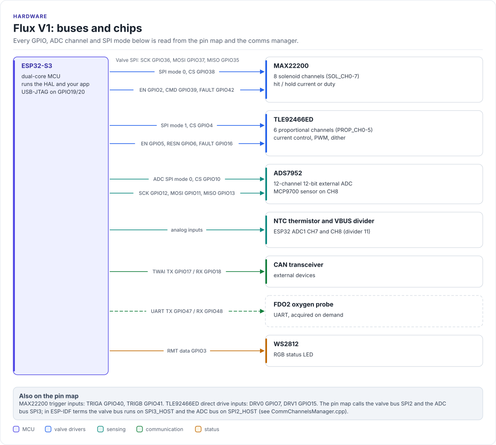

# Hardware

What is on the Flux V1 board, as the software sees it: one ESP32-S3, two SPI buses, the internal ADC, CAN, a UART and
a status LED. The figure and the tables are generated from the board's functional pin map
([`hf_functional_pin_config_flux_v1.hpp`](../../lib/core/hf-core-drivers/internal/hf-pincfg/src/hf_functional_pin_config_flux_v1.hpp))
and the comms manager, so they change when the code changes.

<!-- figure: board-overview -->
<picture>
  <source media="(prefers-color-scheme: dark)" srcset="../diagrams/board-overview.dark.svg">
  
</picture>
<!-- /figure -->

## Chips and who drives them

| Chip | Job | Bus | Software |
| --- | --- | --- | --- |
| ESP32-S3 | Runs the HAL and your application (dual core) | - | ESP-IDF, `lib/api/Flux.h` |
| MAX22200 | Octal solenoid driver: 8 on/off valve channels with hit-and-hold control | Valve SPI, mode 0, 1 MHz | [ValveManager](../managers/valves.md) via `Max22200Handler` |
| TLE92466ED | Six-channel low-side driver with current regulation, PWM and dither, for proportional valves | Valve SPI, mode 1, 1 MHz | [ValveManager](../managers/valves.md) via `Tle92466edHandler` |
| ADS7952 | 12-channel, 12-bit SAR ADC (2.5 V reference) | ADC SPI, mode 0, 4 MHz | [AdcManager](../managers/adc.md) via `Ads7952Handler` |
| MCP9700 | Analog temperature sensor, read on ADS7952 channel 8 | - | [TemperatureManager](../managers/temperature.md) |
| NTC thermistor | Board temperature, 10 kΩ, B = 3950, read on ESP32 ADC1 | - | [TemperatureManager](../managers/temperature.md) |
| VBUS divider | Supply-voltage monitor (divider 11) on ESP32 ADC1 | - | [AdcManager](../managers/adc.md) |
| CAN transceiver | CAN bus at 500 kbit/s through the ESP32 TWAI controller | TWAI | [CommChannelsManager](../managers/comms.md) |
| FDO2 probe port | UART for a PyroScience FDO2-G2 oxygen probe | UART, opened on demand | [CommChannelsManager](../managers/comms.md) `AcquireUart()` |
| WS2812 | One RGB status LED | RMT | [LedManager](../managers/leds.md) |

The SPI modes, clock rates and the CAN bit rate come from
[`CommChannelsManager.cpp`](../../lib/managers/CommChannelsManager.cpp); the NTC values from
[`TemperatureManager.cpp`](../../lib/managers/TemperatureManager.cpp); the MAX22200 full-scale current (1000 mA,
15 kΩ RREF) from [`ValveManager.cpp`](../../lib/managers/ValveManager.cpp).

!!! warning "SPI2 and SPI3 mean two things"
    The pin map names the valve bus `SPI2_*` and the ADC bus `SPI3_*`. In ESP-IDF terms the valve bus runs on
    `SPI3_HOST` (through the GPIO matrix) and the ADC bus on `SPI2_HOST` (native IOMUX pins). Keep this in mind when
    you read ESP-IDF logs or a logic-analyser trace.

There is no I2C bus on Flux V1: `CommChannelsManager::GetI2cBus()` always returns `nullptr`.

## Pin map

Every functional pin and ADC channel, with its GPIO, polarity and pull, is on the [pin map](pin-map.md) page.
