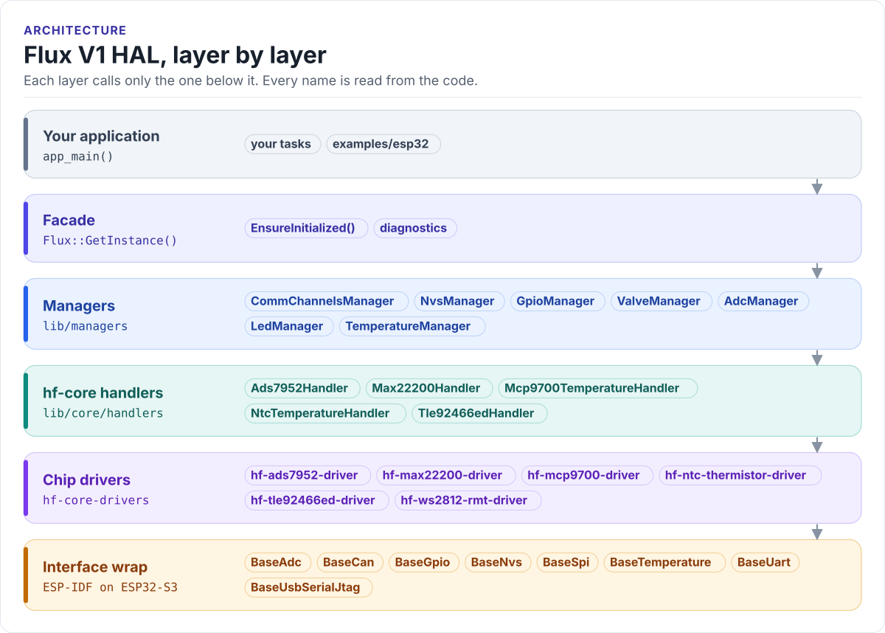

---
hide:
  - navigation
  - toc
---

HardFOC

# Flux V1 HAL

The software layer for the HardFOC Flux V1 valve control board. One `Flux` object gives your ESP32-S3 application
eight solenoid valve channels, six proportional valve channels, analog inputs, temperatures, CAN, storage and a
status LED, through a small set of managers that know the board's wiring.

[Get started](getting-started.md){ .md-button .md-button--primary }
[See the architecture](architecture/index.md){ .md-button }

## What the board is

Flux V1 drives valves. An ESP32-S3 talks over SPI to two valve driver chips: a **MAX22200** for up to eight on/off
solenoid valves (hit-and-hold current or duty control) and a **TLE92466ED** for up to six proportional valves
(regulated coil current, PWM and dither). An **ADS7952** external ADC adds twelve analog inputs, the ESP32-S3's own
ADC reads an NTC thermistor and the supply voltage, and a CAN port, a UART for an oxygen probe and a WS2812 status
LED complete the board. The [hardware page](hardware/index.md) shows every bus and pin.

This repository (`hf-hal-flux-v1`) is the hardware abstraction layer (HAL): it turns that board into C++ objects.
Your application does not touch GPIO numbers or SPI frames; it calls `flux.valves`, `flux.adc`, `flux.temp`.

<!-- figure: hal-layers -->
<picture>
  <source media="(prefers-color-scheme: dark)" srcset="diagrams/hal-layers.dark.svg">
  
</picture>
<!-- /figure -->

## Where to go next

- :material-rocket-launch-outline: **[Get started](getting-started.md)**

    Install ESP-IDF, clone with submodules, build, flash and watch the first example.

- :material-school-outline: **[Learn](learn/index.md)**

    A guided path through these pages, in the order that makes sense.

- :material-chip: **[Hardware](hardware/index.md)**

    Buses, chips and the pin map, generated from the board's pin header.

- :material-layers-outline: **[Architecture](architecture/index.md)**

    Layers, start-up order, ownership, threading and errors.

- :material-valve: **[Managers](managers/index.md)**

    One page per manager: what it does, its API, an example and its pitfalls.

- :material-play-box-outline: **[Examples](examples/index.md)**

    Every buildable app, generated from `app_config.yml`.

